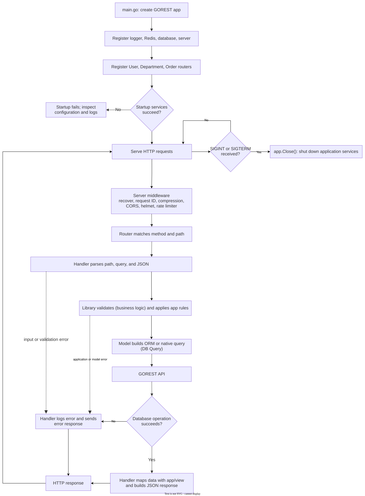

# Architecture and application lifecycle

This guide explains how a request moves through the starter, what each package owns, and the conventions used when adding application code. The implementation follows a layered flow so HTTP concerns, business rules, and database access have clear boundaries.

## Purpose of this starter

GOREST's framework documentation covers the framework APIs. This starter complements it with a complete application example that clients can study and adapt. It demonstrates:

- Resource CRUD organized across router, handler, library, model, entity, and view packages.
- ORM and selected native database query patterns.
- Transactions where the configured database driver supports atomic transactions.
- Database migrations, seeders, request/response DTOs, and application startup.
- Tests and documentation that describe the examples' behavior and driver-specific limits.

Treat the structure and naming conventions in this guide as a recommended starting standard for applications built with GOREST. They are conventions demonstrated by this starter, not requirements imposed by the framework. Use the [GOREST documentation](https://github.com/elsyahtech/gorest/tree/main/docs) for framework APIs and guarantees; use this repository's guides for the behavior implemented by this application. The `/examples` routes are learning examples and do not provide authentication or authorization.

## End-to-end lifecycle

The lifecycle has two stages: application startup, followed by request processing. The diagram describes this repository's wiring; details such as middleware behavior and database APIs are defined by GOREST and its dependencies.



For a successful `POST /examples/departments`, the request path is:

1. `app/router/department_router.go` matches the method and path and calls `CreateDepartment`.
2. The handler in `app/handler/` decodes the JSON body into `entity.Department`.
3. `DepartmentLibrary` in `app/library/` coordinates the operation and applies application-level checks.
4. `DepartmentModel` in `app/model/` uses GOREST's database API to persist the record.
5. The handler builds the response with the GOREST JSON response wrapper. If the operation fails, the handler logs the error and returns an error response instead.

User and order endpoints follow the same layer boundaries. User examples also demonstrate password processing, bulk and upsert writes, ORM queries, and native database access.

## Startup behavior

`main.go` creates an application named `gorest-api-starter` and registers the logger, Redis, database, and HTTP server using configuration from `app/config`. It then registers `UserRouter`, `DepartmentRouter`, and `OrderRouter`.

- SQLite database integration and the HTTP server are enabled using the values in `app/config`.
- The database setup starts from GOREST's `database.ConfigDefault`; the starter points migration/seeder discovery at `app/database` and enables both for local examples. These `Migration=true` / `Seeder=true` settings are not for production; use a controlled migration step and keep sample seeders disabled there.
- Redis is registered as an optional service but disabled.
- Database migrations and seeders are enabled. They run as part of database startup before the application serves requests; a startup failure must be investigated rather than treated as a successful launch.
- Configuration defaults and environment loading live under `app/config/`. The starter reads supported settings from process environment variables and does not load `.env` files automatically. Local startup defaults to SQLite; production requires explicit database and HTTP bind settings, and keeps automatic migrations and sample seeders disabled.
- The routes are grouped below `/examples`.

See [Getting started](./getting-started.md) for local setup and [Configuration](./configuration.md) before using a different environment.

## Package responsibilities

This starter is more than a CRUD application that happens to run: it is a practical map for organizing an application as it grows. A small CRUD example could be written entirely in `main.go`, but that structure becomes difficult to navigate and maintain when more resources, validation, business rules, integrations, and database operations are added. When all of those concerns accumulate together, even a working application can become hard to change safely.

The layers below give each kind of work a clear home. This is the starter's recommended structure for client applications, not structure for structure's sake or a claim that every small feature needs every layer. Follow the boundaries as the application grows so new behavior has a predictable place and the codebase remains understandable, testable, and maintainable over the long term.

| Directory | Responsibility |
|---|---|
| `app/config` | Holds the application's infrastructure settings, such as logging, Redis, database connections, and the HTTP server. |
| `app/router` | Defines which HTTP method and URL reach which handler. It also assembles the model, library, and handler for each resource, connecting the layers without putting request processing or business rules in the route definitions. |
| `app/handler` | The HTTP-facing layer, or request boundary. It receives client requests, decodes and checks incoming data, and passes the relevant input to a library. It then turns the result into an HTTP response. Keep transport-specific work here; do not let handlers become a place where business rules and database operations accumulate. |
| `app/library` | The application/service layer for business logic. It applies rules, calculations, and workflows, and coordinates one or more model operations. For example, user write methods process passwords here. This is where behavior belongs when it is part of the business rather than HTTP or database mechanics. |
| `app/model` | The data-access layer between the application and the database. It performs persistence, retrieval, and database-specific ORM or native queries through GOREST. It should not decide HTTP response formats or own business workflows. |
| `app/entity` | Defines the application's data structures (Go `struct` types), including entities and the request, patch, and response shapes used by the examples. These types give data a clear structure as it moves between layers; they do not perform the work of those layers. |
| `app/view` | Transforms model entities into response DTOs intended for clients, keeping the public response shape separate from the database representation. |
| `app/database/migrations` | Contains driver-specific files for creating or updating database schemas or collections. |
| `app/database/seeders` | Contains driver-specific files for inserting sample or initial data. |

A typical request flows from the router to a handler, then to a library, and from there to a model when database access is needed. The result returns through the layers and is formatted by the handler for the client; a view may shape entity data into a response DTO along the way.

By keeping HTTP handling, business behavior, and database access from accumulating in the same functions, these boundaries make changes easier to locate, test, and review. Use the structure as a guide rather than adding empty layers: a feature may not need every layer, but each responsibility it does have should remain in its appropriate place.

## Naming and file organization

Use the same resource and operation names across layers, with a suffix that identifies the layer:

```text
app/handler/user_create_handler.go   -> UserHandler.CreateUser
app/library/user_create_library.go   -> UserLibrary.CreateUser
app/model/user_create_model.go       -> UserModel.CreateUser
```

Use lowercase filenames with underscores and the pattern `<resource>_<operation>_<layer>.go`. Keep shared types and constructors in a package-named file such as `handler.go`, `library.go`, or `model.go`; do not call such a file `interface.go` unless it actually contains interface declarations.

For exported methods, use **verb + resource + specific behavior**, for example:

- `CreateUser`, `GetUserByID`, `UpdateDepartment`, `DeleteOrder`
- `CreateUserWithTransaction`, `GetUsersWithNativeMongoQuery`
- `CreateUsersInBulk`, `PatchUserActiveStatus`

Prefer `Get` for read methods, and name special behavior explicitly. Keep names aligned through handler, library, model, and router. Add a Go doc comment immediately above each exported declaration; describe the actual behavior (including relevant query constraints), not merely repeat the name.

## Entities, request types, and response DTOs

Entity tags define JSON property names and GOREST database mappings. The user and order entities also reference related resources:

- `User.DepartmentID` identifies a department.
- `Order.UserID` identifies a user.
- `UserResponse` omits the password field; use response DTOs and `app/view` mappings rather than returning a password-bearing entity.
- Patch request structs use pointers for editable fields. This distinguishes an omitted value from explicit zero values such as `false`, `0`, or `""`.

When changing an entity, check all dependent layers: request validation, model queries, response mapping, API examples, migration and seeder files for the supported drivers, and tests.

## Driver boundaries

The starter includes ORM and native query examples for selected drivers, but does not guarantee identical behavior across them. The native SQL user examples use PostgreSQL syntax. MongoDB and ScyllaDB use their native APIs. GOREST `BeginTx`, `Commit`, and `Rollback` calls do not provide SQL-style transaction atomicity for MongoDB and ScyllaDB in these examples. See the [database guide](./database.md) before adapting these operations.
